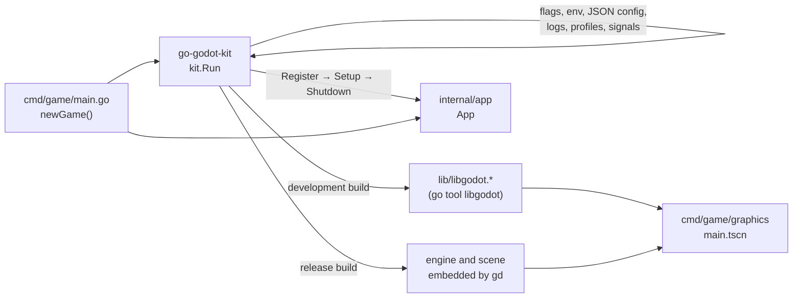

**English** · [Русский](docs/readme/README_ru.md)

# Go Godot Template

Go Godot Template, or tpl, is the starting point for a Go game that embeds Godot through LibGodot. It brings the game skeleton, tests, benchmarks, CI and release builds for six platforms, so a new game starts from an empty scene that already runs, tests and ships.

> [!IMPORTANT]
> The game runs on macOS, Linux and Windows, arm64 and amd64, built with cgo. Flags, config, JSON logs, profiles, the build version and exit on OS signals come from [go-godot-kit](https://github.com/shigabutdinoff/go-godot-kit), so the platforms and the [graphics.gd](https://github.com/quaadgras/graphics.gd) version are kit's.

The game itself is an empty 3D scene with a camera.

## Documentation

For [installation options see below](#installation), for usage instructions see the package documentation:

```shell
go doc ./cmd/game        # usage, flags and exit codes
go doc ./internal/app    # dependencies, workers and the hooks
```

`internal/app/example_test.go` shows a game with a worker and a fatal error.

## Contributing

Every task goes in its own branch from the repository's default branch (`master` in the template, `main` or the name you chose in a game made by go-godot-kit) and reaches it through a pull request after CI passes, so the default branch holds only reviewed code. CI and the develop sync run on pushes to `master` or `main` only when it is the default branch; with another name, add it to `branches` in `ci.yml` and `sync-develop.yml`. Before sending a pull request, run the same checks as CI:

```shell
golangci-lint fmt                                  # gofmt and goimports
go test -race -count=1 -cover ./...
go test -run '^$' -bench . -benchmem ./...         # benchmarks with allocations
go tool staticlint ./... && golangci-lint run
GOOS=windows go vet ./... && GOOS=windows go build -o /dev/null ./...
go generate ./... && test -z "$(git status --porcelain)"   # generated code is up to date
go run ./cmd/game -- --headless --quit             # the engine starts the scene and exits with 0, needs lib/
```

[CI](.github/workflows/ci.yml) runs them in pull requests on one Linux runner (the release workflow runs them on macOS, Linux and Windows, arm64 and amd64), requires 70% coverage (the `COVERAGE_MIN` repository variable) and scans `go.mod` for known vulnerabilities with Trivy.

`go generate` runs `go tool reset`, which writes `Reset()` methods for structs marked `// generate:reset`. The template has none yet, so it writes nothing. `staticlint` (go vet passes, staticcheck, errcheck, ineffassign and a check against `os.Exit` in `main`) and `reset` live in go-godot-kit and come in through the `tool` directives in `go.mod`, so every game on the kit shares one copy. `staticcheck.conf` holds the course's staticcheck settings; golangci-lint reads its copy in `.golangci.yml`.

## Installation

### From the template

Click **Use this template** on GitHub, or create the repository with the GitHub CLI. The new game starts with one commit holding the template's files, without its history:

```shell
gh repo create mygame --public --clone --template shigabutdinoff/go-godot-tpl
```

Then change the module path in `go.mod` and the imports, and [rename the game](#renaming-the-game). You need Go from `go.mod` and a C compiler for cgo:

```shell
cd mygame
go tool libgodot             # once per machine: put LibGodot into lib/
go run ./cmd/game            # start the game
go run ./cmd/game -h         # flags
go run ./cmd/game -- --verbose  # Godot arguments go after --
```

### LibGodot

The development build finds LibGodot in `lib/` (not in git) through the rpath in `cmd/game/rpath.go`. `go tool libgodot` builds it from Godot sources and names the missing tools, but does not install them: git, Python, scons, and on macOS also Xcode and MoltenVK (`brew install scons molten-vk`).

The first build takes 5 minutes to an hour. The result stays in the user cache, so the next project on the machine gets it in a second.

### Renaming the game

Rename `cmd/game` and change `Name` and `EnvPrefix` in `main.go`. The release workflow takes the game name from the directory.

### Release builds

Run the **release** workflow from the Actions tab on the default branch with a version: a SemVer `vX.Y.Z`, or `vX.Y.Z-rc.1` for a prerelease that never turns Latest; any other value, or a version already released, fails at once. It runs CI on the commit first, builds only if CI passes, then publishes a GitHub Release and tags the commit with the version:

```shell
gh workflow run release.yml -f version=v1.2.3
gh workflow run release.yml -f version=v1.2.4 -f linux-arm64=false -f windows-arm64=false
```

Each of the seven archives has its own tick: `darwin-universal`, `darwin-arm64`, `darwin-amd64`, `linux-amd64`, `linux-arm64`, `windows-amd64`, `windows-arm64`. All are ticked by default. Only the ticked ones are built and published, and only their runners start, CI's included: macOS on macos-26 (arm64, universal) and macos-15-intel (amd64, universal), the others on the runner of their OS and architecture. CI's ubuntu-24.04 with the linters and the `engine` job run every time. With nothing ticked the run fails at once, before CI and the builds start.

Without `--ref`, `gh` runs it on the default branch. Run it there: the engine cache it saves serves every later release, while a cache saved elsewhere serves only that branch. GitHub drops a cache unused for 7 days, so a release after a longer pause builds the engine anew, up to an hour.

The release stays a draft until every archive is uploaded. A rerun after a failed run replaces the draft's archives; a published version never changes, so a fix goes out under a new version. To roll back, download the previous version from the Releases page.

`gd build` embeds the engine and the scene. The archives are `game-<version>-<os>-<arch>` for macOS (`.app`: universal, arm64 and amd64), Linux (musl) and Windows, each with a `.sha256`. The version, date and commit go in through `-ldflags "-X main.buildVersion=…"` and are printed at start. macOS amd64 is built on the arm64 runner and Windows arm64 on the amd64 one: gd's LLVM has no download for the other two hosts. Every built binary is started with `-version` and must print the release version, except Windows arm64, which an amd64 runner cannot run.

That check does not start the engine: graphics.gd drops `--headless` from a release's arguments. The release workflow's `engine` job catches a broken scene instead: on Linux it builds LibGodot (up to an hour, then cached by `go.sum`), starts the development build headless, and the release is published only if it passes. Pull requests do not run it, so their CI takes minutes.

## Configuration

A setting comes from, in order of precedence: `GAME_*` environment variables, flags, the JSON file from `-c`, `-config`, `CONFIG` or `GAME_CONFIG`, defaults.

| Flag | Env | Meaning |
|---|---|---|
| `-version` | | print the version and exit |
| `-project <dir>` | `GAME_PROJECT` | Godot project, `cmd/game/graphics` by default |
| `-log-level <level>` | `GAME_LOG_LEVEL` | `debug`, `info` (default), `warn`, `error` |
| `-log-file <file>` | `GAME_LOG_FILE` | append JSON logs to a file instead of stderr |
| `-cpuprofile <file>` | `GAME_CPU_PROFILE` | CPU profile from start to exit |
| `-memprofile <file>` | `GAME_MEM_PROFILE` | heap profile on exit |
| `-c`, `-config <file>` | `CONFIG`, `GAME_CONFIG` | JSON settings file |

The game exits with 0 on success or `-h`, 1 on error, 2 on invalid arguments.

The JSON file holds every setting. `godot_args` are used when the command line has none after `--`:

```json
{
  "project": "cmd/game/graphics",
  "log_level": "info",
  "log_file": "game.log",
  "cpu_profile": "cpu.out",
  "mem_profile": "mem.out",
  "godot_args": ["--verbose"]
}
```

Keep API keys and tokens out of the JSON file and the logs. Pass them through `GAME_*` environment variables.

## Logs

Logs are JSON lines through `log/slog`, one record per line, with the OpenTelemetry resource attributes `service.name`, `service.version` and `service.instance.id` (new on every run). Use the `debug` level for diagnostics. Pass data as fields, not inside the message, tag records with the component and name your own fields `custom.*`, apart from the OpenTelemetry ones and the record's `level`, `time` and `msg`:

```go
log := slog.With("component", "world")
log.DebugContext(ctx, "level loaded", "custom.level", name, "custom.enemies", len(enemies))
```

Stderr is for development. For real runs set `log_file` in the config or `GAME_LOG_FILE`, so the logs are kept. A Windows release has no console and needs this most.

## Profiling

```shell
go run ./cmd/game -cpuprofile cpu.out -memprofile mem.out
go tool pprof -http=:9090 cpu.out
go tool pprof -top -diff_base=base.out result.out   # compare two runs, before and after a change
```

A run of the game allocates about 2 MB on the Go heap, all of it in kit and the runtime. The template's own code shows up only in the benchmarks. [`profiles/`](profiles) keeps their heap profiles: `base.pprof` before `internal/app` moved from a mutex to channels, `result.pprof` after:

```shell
go test ./internal/app -run '^$' -bench . -benchtime=100000x -benchmem -memprofilerate=1 -memprofile profiles/result.pprof
go tool pprof -top -diff_base=profiles/base.pprof profiles/result.pprof
```

```text
File: app.test
Type: alloc_space
Time: 2026-11-18 01:25:41 MSK
Showing nodes accounting for 53.41MB, 79.79% of 66.94MB total
Dropped 56 nodes (cum <= 0.33MB)
      flat  flat%   sum%        cum   cum%
   56.46MB 84.34% 84.34%    56.46MB 84.34%  github.com/shigabutdinoff/go-godot-tpl/internal/app.New (inline)
  -45.78MB 68.39% 15.96%   -54.93MB 82.07%  github.com/shigabutdinoff/go-godot-tpl/internal/app.(*App).Setup
   36.62MB 54.71% 70.67%    45.78MB 68.39%  github.com/shigabutdinoff/go-godot-tpl/internal/app.(*App).run
    6.10MB  9.11% 79.78%     6.16MB  9.20%  context.(*cancelCtx).Done
    0.01MB 0.015% 79.79%     6.17MB  9.22%  github.com/shigabutdinoff/go-godot-tpl/internal/app.BenchmarkLifecycle.func1
         0     0% 79.79%    -0.95MB  1.42%  github.com/shigabutdinoff/go-godot-tpl/internal/app.(*App).Setup.func1
         0     0% 79.79%     7.12MB 10.64%  github.com/shigabutdinoff/go-godot-tpl/internal/app.(*App).run.func1
         0     0% 79.79%     1.52MB  2.27%  github.com/shigabutdinoff/go-godot-tpl/internal/app.BenchmarkLifecycle
         0     0% 79.79%     1.52MB  2.27%  testing.(*B).run1.func1
         0     0% 79.79%     1.52MB  2.27%  testing.(*B).runN
```

The diff is positive: channels allocate more than the mutex did (`BenchmarkLifecycle`: 1223 B in 20 allocs/op). The game pays it once, for goroutines that share no memory. `New` makes five channels, and the workers' goroutines moved from `Setup` to `run`. `Fail`, the only path called repeatedly, still allocates nothing (`BenchmarkFail`: 0 allocs/op).

## Architecture



```text
cmd/game/
  main.go       game description for kit.Run
  main_test.go  test of the game description
  doc.go        usage, flags and exit codes
  rpath.go      development build: finds LibGodot in lib/
  graphics/     Godot project: project.godot, main.tscn, assets
internal/
  app/          dependencies, workers and the hooks; tests, example, benchmarks
profiles/       heap profiles of the benchmarks before and after a change
lib/            LibGodot for development builds, not in git
```

Keep `cmd/game` thin. Put the game code into packages under `internal/`, such as `internal/world` or `internal/save`, and pass them to `app.New` as dependencies. Give each new package tests, an `example_test.go` and benchmarks of its hot paths.

`kit.Run` parses the settings, starts the engine and calls the hooks: `Register` before the scene loads, `Setup` once it is loaded, `Shutdown` after the engine stops, for 5 s at most. Their `ctx` is canceled on SIGINT, SIGTERM or SIGQUIT; on Windows on Ctrl+C, Ctrl+Break or closing the console. A second signal kills the process without `Shutdown`.

The game's goroutines are workers, `func(ctx context.Context) error`, passed to `app.New`. `Setup` starts them. Their `ctx` is canceled by `Fail`, by the first error a worker returns, by an OS quit signal and by `Shutdown`, which waits for them:

- A worker that returns `ctx.Err()` or nil on cancel stops normally.
- Any other error, and a `context.Canceled` from a ctx of the worker's own while the game runs, goes to `Fail` wrapped with the worker's index in `app.New` (`worker 1: …`) and is logged at once.
- If the workers do not stop before the `ctx` of `Shutdown` expires, `Shutdown` stops waiting, logs it and returns the error.

`Setup` has no error result. On a fatal error call `a.Fail(ctx, err)` and quit the scene tree: `Shutdown` returns the first error passed to `Fail`, and the game exits with code 1. A worker's error stops the other workers but not the scene, so the game exits with code 1 when the player quits.

## Comparison with go-godot-kit

[go-godot-kit](https://github.com/shigabutdinoff/go-godot-kit) is a library: it runs the engine and leaves the game to you. tpl is a game already wired to it. On top of `kit.Run` it adds `internal/app` with workers, `Fail` and a bounded `Shutdown`, a Godot project with a scene, tests and benchmarks, CI with a coverage gate and Trivy, and a release workflow that publishes archives with checksums for every platform. Start from tpl for a new game; use kit directly to add the launcher to an existing one.
