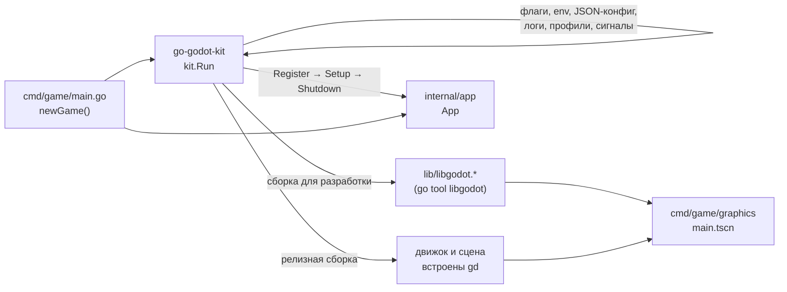

[English](../../README.md) · **Русский**

# Go Godot Template

Go Godot Template, или tpl, — заготовка игры на Go со встроенным через LibGodot движком Godot. В ней уже есть каркас игры, тесты, бенчмарки, CI и релизные сборки для шести платформ, так что новая игра начинается с пустой сцены, которая уже запускается, проходит тесты и выпускается.

> [!IMPORTANT]
> Игра работает на macOS, Linux и Windows, arm64 и amd64, в сборке с cgo. Флаги, конфиг, JSON-логи, профили, версия сборки и выход по сигналам ОС приходят из [go-godot-kit](https://github.com/shigabutdinoff/go-godot-kit), поэтому платформы и версия [graphics.gd](https://github.com/quaadgras/graphics.gd) — те же, что у kit.

Сама игра — пустая 3D-сцена с камерой.

## Документация

[Варианты установки — ниже](#установка), инструкции по использованию — в документации пакетов:

```shell
go doc ./cmd/game        # запуск, флаги и коды выхода
go doc ./internal/app    # зависимости, воркеры и хуки
```

В `internal/app/example_test.go` — игра с воркером и фатальной ошибкой.

## Участие в разработке

Каждая задача делается в своей ветке от `master` и попадает в `master` через pull request после прохождения CI, поэтому в `master` только проверенный код. Перед pull request запустите те же проверки, что и CI:

```shell
golangci-lint fmt                                  # gofmt и goimports
go test -race -count=1 -cover ./...
go test -run '^$' -bench . -benchmem ./...         # бенчмарки с аллокациями
go tool staticlint ./... && golangci-lint run
GOOS=windows go vet ./... && GOOS=windows go build -o /dev/null ./...
go generate ./... && test -z "$(git status --porcelain)"   # сгенерированный код актуален
go run ./cmd/game -- --headless --quit             # движок запускает сцену и выходит с 0, нужен lib/
```

[CI](../../.github/workflows/ci.yml) запускает их в PR на одном раннере Linux (workflow релиза — на macOS, Linux и Windows, arm64 и amd64), требует покрытия 70% (переменная репозитория `COVERAGE_MIN`) и проверяет `go.mod` на известные уязвимости через Trivy.

`go generate` запускает `go tool reset`, который пишет методы `Reset()` для структур с пометкой `// generate:reset`. В шаблоне таких пока нет, поэтому он ничего не пишет. `staticlint` (проходы go vet, staticcheck, errcheck, ineffassign и проверка на `os.Exit` в `main`) и `reset` живут в go-godot-kit и подключаются директивами `tool` в `go.mod`, так что у всех игр на kit одна их копия. В `staticcheck.conf` — настройки staticcheck из курса; golangci-lint читает их копию в `.golangci.yml`.

## Установка

### Из шаблона

Нажмите **Use this template** на GitHub или создайте репозиторий через GitHub CLI. Новая игра начинается с одного коммита с файлами шаблона, без его истории:

```shell
gh repo create mygame --public --clone --template shigabutdinoff/go-godot-tpl
```

Затем поменяйте путь модуля в `go.mod` и импортах и [переименуйте игру](#переименование-игры). Нужны Go из `go.mod` и компилятор C для cgo:

```shell
cd mygame
go tool libgodot             # один раз на машину: положить LibGodot в lib/
go run ./cmd/game            # запустить игру
go run ./cmd/game -h         # флаги
go run ./cmd/game -- --verbose  # аргументы Godot идут после --
```

### LibGodot

Сборка для разработки находит LibGodot в `lib/` (не в git) через rpath в `cmd/game/rpath.go`. `go tool libgodot` собирает его из исходников Godot и называет недостающие инструменты, но не ставит их: git, Python, scons, а на macOS ещё Xcode и MoltenVK (`brew install scons molten-vk`).

Первая сборка идёт от 5 минут до часа. Результат остаётся в пользовательском кэше, и следующий проект на машине получает его за секунду.

### Переименование игры

Переименуйте `cmd/game` и поменяйте `Name` и `EnvPrefix` в `main.go`. Workflow релиза берёт имя игры из имени каталога.

### Релизные сборки

Запустите workflow **release** на вкладке Actions. Сначала он прогоняет CI на коммите и собирает, только если CI прошёл. На ветке он выкладывает архивы как артефакты запуска. На SemVer-теге `vX.Y.Z` он ещё публикует GitHub Release; `vX.Y.Z-rc.1` становится пре-релизом, который никогда не станет Latest, а любой другой тег роняет сборку:

```shell
git tag v1.2.3 && git push origin v1.2.3   # затем запустить "release" на теге
```

Релиз остаётся черновиком, пока не загружены все архивы. Перезапуск после упавшего запуска заменяет архивы черновика; перезапуск на опубликованном релизе падает, потому что опубликованная версия не меняется. Поставьте новый тег. Чтобы откатиться, скачайте предыдущую версию со страницы Releases.

`gd build` встраивает движок и сцену. Архивы называются `game-<version>-<os>-<arch>`: для macOS (`.app`: universal, arm64 и amd64), Linux (musl) и Windows, у каждого есть `.sha256`. Версия, дата и коммит передаются через `-ldflags "-X main.buildVersion=…"` и печатаются при старте. macOS amd64 собирается на раннере arm64, а Windows arm64 — на раннере amd64: у LLVM, который скачивает gd, нет сборки для двух других хостов. Каждый собранный бинарник запускается с `-version` и должен напечатать версию релиза, кроме Windows arm64: раннер amd64 его не запустит.

Эта проверка не запускает движок: graphics.gd убирает `--headless` из аргументов релиза. Сломанную сцену ловит задача `engine` в workflow релиза: на Linux она собирает LibGodot (до часа, дальше кэш по `go.sum`), запускает сборку для разработки без окна, и релиз публикуется, только если она прошла. В PR она не идёт, поэтому их CI занимает минуты.

## Настройки

Настройка берётся по убыванию приоритета: переменные окружения `GAME_*`, флаги, JSON-файл из `-c`, `-config`, `CONFIG` или `GAME_CONFIG`, значения по умолчанию.

| Флаг | Переменная | Значение |
|---|---|---|
| `-version` | | напечатать версию и выйти |
| `-project <dir>` | `GAME_PROJECT` | проект Godot, по умолчанию `cmd/game/graphics` |
| `-log-level <level>` | `GAME_LOG_LEVEL` | `debug`, `info` (по умолчанию), `warn`, `error` |
| `-log-file <file>` | `GAME_LOG_FILE` | дописывать JSON-логи в файл вместо stderr |
| `-cpuprofile <file>` | `GAME_CPU_PROFILE` | профиль CPU от старта до выхода |
| `-memprofile <file>` | `GAME_MEM_PROFILE` | профиль кучи при выходе |
| `-c`, `-config <file>` | `CONFIG`, `GAME_CONFIG` | JSON-файл настроек |

Игра выходит с 0 при успехе или `-h`, с 1 при ошибке, с 2 при неверных аргументах.

В JSON-файле есть все настройки. `godot_args` берутся, когда в командной строке после `--` ничего нет:

```json
{
  "project": "cmd/game/graphics",
  "log_level": "info",
  "log_file": "game.log",
  "cpu_profile": "cpu.out",
  "mem_profile": "mem.out",
  "godot_args": ["--verbose"]
}
```

Не кладите API-ключи и токены в JSON-файл и логи. Передавайте их через переменные окружения `GAME_*`.

## Логи

Логи — JSON-строки через `log/slog`, по записи на строку, с атрибутами ресурса OpenTelemetry `service.name`, `service.version` и `service.instance.id` (новый при каждом запуске). Для диагностики используйте уровень `debug`. Передавайте данные полями, а не внутри сообщения, помечайте записи компонентом и называйте свои поля `custom.*`, отдельно от полей OpenTelemetry и собственных полей записи `level`, `time` и `msg`:

```go
log := slog.With("component", "world")
log.DebugContext(ctx, "level loaded", "custom.level", name, "custom.enemies", len(enemies))
```

Stderr — для разработки. Для настоящих запусков задайте `log_file` в конфиге или `GAME_LOG_FILE`, чтобы логи сохранялись. У релиза под Windows нет консоли, и ему это нужнее всего.

## Профилирование

```shell
go run ./cmd/game -cpuprofile cpu.out -memprofile mem.out
go tool pprof -http=:9090 cpu.out
go tool pprof -top -diff_base=base.out result.out   # сравнить два запуска, до и после изменения
```

Запуск игры выделяет около 2 МБ в куче Go, и всё это — kit и рантайм. Собственный код шаблона виден только в бенчмарках. В [`profiles/`](../../profiles) лежат их профили кучи: `base.pprof` до перехода `internal/app` с мьютекса на каналы, `result.pprof` после:

```shell
go test ./internal/app -run '^$' -bench . -benchtime=100000x -benchmem -memprofilerate=1 -memprofile profiles/result.pprof
go tool pprof -top -diff_base=profiles/base.pprof profiles/result.pprof
```

```text
File: app.test
Type: alloc_space
Time: 2026-11-18 01:25:41 MSK
Showing nodes accounting for 53.41MB, 79.79% of 66.94MB total
Dropped 56 nodes (cum <= 0.33MB)
      flat  flat%   sum%        cum   cum%
   56.46MB 84.34% 84.34%    56.46MB 84.34%  github.com/shigabutdinoff/go-godot-tpl/internal/app.New (inline)
  -45.78MB 68.39% 15.96%   -54.93MB 82.07%  github.com/shigabutdinoff/go-godot-tpl/internal/app.(*App).Setup
   36.62MB 54.71% 70.67%    45.78MB 68.39%  github.com/shigabutdinoff/go-godot-tpl/internal/app.(*App).run
    6.10MB  9.11% 79.78%     6.16MB  9.20%  context.(*cancelCtx).Done
    0.01MB 0.015% 79.79%     6.17MB  9.22%  github.com/shigabutdinoff/go-godot-tpl/internal/app.BenchmarkLifecycle.func1
         0     0% 79.79%    -0.95MB  1.42%  github.com/shigabutdinoff/go-godot-tpl/internal/app.(*App).Setup.func1
         0     0% 79.79%     7.12MB 10.64%  github.com/shigabutdinoff/go-godot-tpl/internal/app.(*App).run.func1
         0     0% 79.79%     1.52MB  2.27%  github.com/shigabutdinoff/go-godot-tpl/internal/app.BenchmarkLifecycle
         0     0% 79.79%     1.52MB  2.27%  testing.(*B).run1.func1
         0     0% 79.79%     1.52MB  2.27%  testing.(*B).runN
```

Разница положительная: каналы выделяют больше, чем мьютекс (`BenchmarkLifecycle`: 1223 B за 20 allocs/op). Игра платит это один раз — за горутины без общей памяти. `New` создаёт пять каналов, а горутины воркеров переехали из `Setup` в `run`. `Fail`, единственный путь, который вызывается многократно, по-прежнему ничего не выделяет (`BenchmarkFail`: 0 allocs/op).

## Архитектура



```text
cmd/game/
  main.go       описание игры для kit.Run
  main_test.go  тест описания игры
  doc.go        запуск, флаги и коды выхода
  rpath.go      сборка для разработки: находит LibGodot в lib/
  graphics/     проект Godot: project.godot, main.tscn, ассеты
internal/
  app/          зависимости, воркеры и хуки; тесты, пример, бенчмарки
profiles/       профили кучи бенчмарков до и после изменения
lib/            LibGodot для сборок разработки, не в git
```

Держите `cmd/game` тонким. Код игры кладите в пакеты под `internal/`, например `internal/world` или `internal/save`, и передавайте их в `app.New` как зависимости. У каждого нового пакета должны быть тесты, `example_test.go` и бенчмарки горячих путей.

`kit.Run` разбирает настройки, запускает движок и вызывает хуки: `Register` до загрузки сцены, `Setup` после загрузки, `Shutdown` после остановки движка, не дольше 5 с. Их `ctx` отменяется по SIGINT, SIGTERM или SIGQUIT; на Windows — по Ctrl+C, Ctrl+Break или закрытию консоли. Второй сигнал убивает процесс без `Shutdown`.

Горутины игры — это воркеры, `func(ctx context.Context) error`, которые передаются в `app.New`. `Setup` запускает их. Их `ctx` отменяют `Fail`, первая ошибка воркера, сигнал выхода ОС и `Shutdown`, который их ждёт:

- Воркер, который при отмене возвращает `ctx.Err()` или nil, останавливается штатно.
- Любая другая ошибка, а также `context.Canceled` от собственного ctx воркера, пока игра работает, уходит в `Fail` с номером воркера в `app.New` (`worker 1: …`) и сразу пишется в лог.
- Если воркеры не остановились до истечения `ctx` у `Shutdown`, `Shutdown` перестаёт ждать, пишет об этом в лог и возвращает ошибку.

У `Setup` нет результата-ошибки. При фатальной ошибке вызовите `a.Fail(ctx, err)` и завершите дерево сцены: `Shutdown` вернёт первую ошибку, переданную в `Fail`, и игра выйдет с кодом 1. Ошибка воркера останавливает остальных воркеров, но не сцену, поэтому игра выйдет с кодом 1, когда игрок её закроет.

## Сравнение с go-godot-kit

[go-godot-kit](https://github.com/shigabutdinoff/go-godot-kit) — библиотека: она запускает движок, а игру оставляет вам. tpl — игра, уже подключённая к нему. Поверх `kit.Run` в нём есть `internal/app` с воркерами, `Fail` и ограниченным по времени `Shutdown`, проект Godot со сценой, тесты и бенчмарки, CI с порогом покрытия и Trivy и workflow релиза, который публикует архивы с контрольными суммами для каждой платформы. Новую игру начинайте с tpl; kit напрямую подключайте, чтобы добавить запускатель в существующую.
